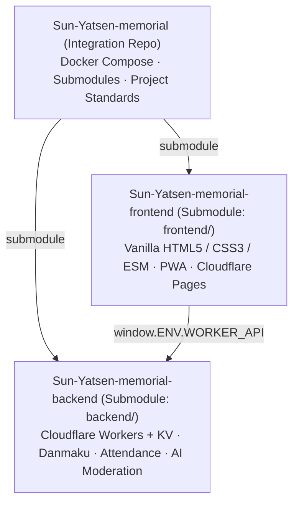

# 私立中山紀念堂 (Private Sun Yat-sen Memorial Hall)

A commemorative web application honoring Dr. Sun Yat-sen and the pioneers of the Chinese Republican revolution. The project serves as both a solemn digital memorial and a technical exploration of framework-free multimedia playback, immersive interaction, responsive Apple-style UI, and serverless moderation.

---

## Repository Architecture

This project is structured as an integration repository combining two independent Git submodules:



| Repository | Role | Hosting Target | README |
|---|---|---|---|
| [Sun-Yatsen-memorial](https://github.com/Aquarius-Situla/Sun-Yatsen-memorial) | Integration, Docker/Nginx orchestration, project standards | Docker / Self-hosted | This file |
| [Sun-Yatsen-memorial-frontend](https://github.com/Aquarius-Situla/Sun-Yatsen-memorial-frontend) | Pure static client application & Admin Dashboard | Cloudflare Pages / Nginx / Static host | [frontend/README.md](frontend/README.md) |
| [Sun-Yatsen-memorial-backend](https://github.com/Aquarius-Situla/Sun-Yatsen-memorial-backend) | Serverless API for Danmaku, attendance, filtering & AI matrix | Cloudflare Workers + KV | [backend/README.md](backend/README.md) |

---

## Features & Tech Stack

- **Ritual Interaction** — Interactive three-bow ceremony before the presidential portrait, paired with sequential memorial music playback.
- **Contextual Audio** — Background music automatically switches based on the current date or active historical event page.
- **Republican Calendar & i18n** — Displays the current date in the Republic of China (Minguo) era with Traditional/Simplified Chinese support.
- **PWA & Responsive Shell** — Web App Manifest, iOS splash screens, `apple-touch-icon`, mobile tab bar, and desktop parallax shell.
- **Historical Archive** — Includes Dr. Sun Yat-sen's last will, biographical timeline, library hub, and dedicated commemorative event pages.
- **Danmaku, Attendance & AI Moderation** — Live bullet comments and daily visitor attendance backed by Cloudflare Workers KV, multi-layer word filtering, PlayCaptcha human verification, and async LLM moderation.

| Layer | Technology |
|---|---|
| Frontend | HTML5 / Vanilla CSS3 / Vanilla JavaScript (ES Modules) |
| Backend | Cloudflare Workers + Cloudflare Workers KV |
| Self-Hosted Orchestration | Docker (`nginx:alpine`) + Nginx |

---

## Directory Structure

```text
sys-memorial/
├── frontend/                   # [Submodule] Static web application (Cloudflare Pages / Nginx)
│   ├── .github/workflows/      # Multi-arch GHCR Docker image CI
│   ├── index.html              # Application entry point
│   ├── api/                    # Runtime env config (env.example.js) & word list archives
│   ├── captcha/                # Isolated PlayCaptcha iframe bundle
│   ├── css/                    # Base, variables, markdown, and component stylesheets
│   ├── docker/                 # Nginx config & runtime env.js entrypoint script
│   ├── events/                 # Commemorative event pages & celebration triggers
│   ├── js/                     # App orchestrators and modular ES modules
│   ├── main/                   # Core styles, portrait, audio tracks, and favicons
│   ├── pages/                  # Subpages (about, admin, announcement, biography, library, settings, thanks)
│   ├── tools/                  # Bundled PlayCaptcha builder source
│   ├── webapp/                 # PWA manifest, icons, and iOS splash screens
│   ├── Dockerfile              # Nginx Alpine container build
│   └── LICENSE                 # AGPL-3.0 License
├── backend/                    # [Submodule] Serverless API (Cloudflare Workers / Docker)
│   ├── .github/workflows/      # GHCR Docker image CI & Cloudflare Workers deploy CI
│   ├── workers.js              # ES Module Worker router, KV logic, auth, and AI moderation
│   ├── server.mjs              # Node.js HTTP & file-backed KV adapter for Docker
│   ├── wrangler.toml           # Wrangler deployment configuration
│   ├── Dockerfile              # Node 22 Alpine container build
│   └── LICENSE                 # AGPL-3.0 License
├── tools/                      # Standalone PlayCaptcha builder workspace
│   └── captcha_builder/
├── docs/                       # Supplementary component documentation
├── bugfix/                     # Archive of bug post-mortems
├── docker-compose.yml          # Local Docker Compose config mounting ./frontend into Nginx
├── docker-compose.ghcr.yml     # Full-stack Compose using prebuilt GHCR frontend & backend images
├── .gitmodules                 # Submodule mappings for frontend/ and backend/
├── LICENSE                     # AGPL-3.0 License
└── README.md
```

---

## Clone & Submodule Workflow

### Cloning with Submodules

Clone the repository together with `frontend/` and `backend/`:

```bash
git clone --recurse-submodules git@github.com:Aquarius-Situla/Sun-Yatsen-memorial.git
```

If you already cloned without `--recurse-submodules`:

```bash
git submodule update --init --recursive
```

### Committing Changes Across Repositories

Because `frontend/` and `backend/` are independent Git repositories, commit and push changes inside the respective submodule **before** updating the submodule pointer in the integration repository:

1. Commit and push inside `frontend/` or `backend/`:
   ```bash
   cd frontend   # or cd backend
   git add .
   git commit -m "your commit message"
   git push origin main
   ```
2. Update the submodule reference in the root repository:
   ```bash
   cd ..
   git add frontend backend
   git commit -m "chore: update submodule pointers"
   git push origin main
   ```

---

## Deployment Overview

### Option A: Docker Compose (Prebuilt GHCR Images — Full Stack)

Prebuilt multi-architecture (`linux/amd64`, `linux/arm64`) frontend and backend images are published to GitHub Container Registry (`ghcr.io`) via GitHub Actions inside each submodule.

```bash
export ADMIN_SECRET="your-strong-admin-passphrase"
export WORKER_API="http://localhost:8787"
docker compose -f docker-compose.ghcr.yml up -d
```

See [docker-compose.ghcr.yml](docker-compose.ghcr.yml) for port mappings and persistent `/data` KV storage configuration.

### Option B: Docker + Nginx (Local `./frontend` Mount)

1. Configure the frontend API endpoint by copying `frontend/api/env.example.js` to `frontend/api/env.js` and setting `WORKER_API` to your deployed backend URL.
2. Ensure the external Docker network `npm_default` exists (created by Nginx Proxy Manager), or uncomment `ports` in [docker-compose.yml](docker-compose.yml) for direct local access.
3. Start the container:
   ```bash
   docker-compose up -d
   ```

[docker-compose.yml](docker-compose.yml) mounts `./frontend` as a read-only volume (`/usr/share/nginx/html:ro`) into `nginx:alpine`.

### Option C: Cloudflare Serverless (Pages & Workers)

1. **Backend**: Deploy `backend/` via GitHub Actions, Wrangler CLI, or the Cloudflare Dashboard, bind the `MEMORIAL_KV` namespace, and configure the required `ADMIN_SECRET` secret. See [backend/README.md](backend/README.md).
2. **Frontend**: Connect `Sun-Yatsen-memorial-frontend` to Cloudflare Pages (empty build command, output directory `/`) and configure `frontend/api/env.js` with your Worker URL. See [frontend/README.md](frontend/README.md).

---

## Prohibited Words Synchronization

> [!WARNING]
> Placing or editing `.json` files inside `frontend/api/prohibited_words/` (`public.json` or the gitignored `private.json`) **has no effect on the live production filter**. Those files serve strictly as local archives/templates.

To enforce prohibited word lists in production, log into the **Admin Dashboard** (`/#admin` or `/pages/admin/index.html`) and upload `public.json` / `private.json` under **Danmaku Management** to sync them into the backend `MEMORIAL_KV` store.

---

## AI Agent & Maintainer Guidelines

When contributing to or maintaining any repository in this project, AI assistants and developers **must** adhere to these rules:

- **English Comments Only**: All code comments, headers, and developer notes inside `.html`, `.js`, `.css`, `.yml`, and `.toml` source files must be written in English.
- **Block Comments Only**: Single-line comments (`//`) are strictly prohibited in JS/CSS/HTML source files. Use block comments (`/* ... */` for JS/CSS, `<!-- ... -->` for HTML, full-line `#` for YAML/TOML).
- **Display String Integrity**: Do not alter or translate user-facing Traditional/Simplified Chinese UI copy, banners, or toasts unless explicitly requested.
- **No Temporary Notes**: Never commit debugging remarks or temporary workarounds. Place any scratch/test scripts under `/temp/[feature_name]/` (gitignored).
- **PlayCaptcha Isolation (CRITICAL)**: **NEVER** dynamically inject React/ReactDOM UMD scripts into host pages. Always use the isolated `iframe` wrapper pointing to `frontend/captcha/index.html` and trigger via `showCaptchaModal` in [frontend/js/modules/captcha.js](frontend/js/modules/captcha.js). See [frontend/README.md](frontend/README.md) for integration details.

---

## Open Source Acknowledgements

This project builds on the following MIT-licensed open-source components:

- **zero-md** — Client-side Markdown renderer. Copyright (c) 2018 Jason Lee.
- **github-markdown-css** — Markdown typography stylesheet. Copyright (c) Sindre Sorhus.
- **playcaptcha** — Interactive claw-machine captcha component. Copyright (c) 2026 iisac.

---

## Licensing

This project uses a dual-license model:

- **Source code** — Released under the [GNU Affero General Public License v3.0 (AGPL-3.0)](LICENSE).
- **Audiovisual assets** — Portraits, musical recordings, and historical media remain the property of their respective copyright holders and are **not** covered by AGPL-3.0. Unauthorized commercial or improper reuse is prohibited. See [frontend/pages/about/about_tc.md](frontend/pages/about/about_tc.md) (Traditional Chinese) or [frontend/pages/about/about_sc.md](frontend/pages/about/about_sc.md) (Simplified Chinese).

---

*「革命尚未成功，同志仍須努力。」*
